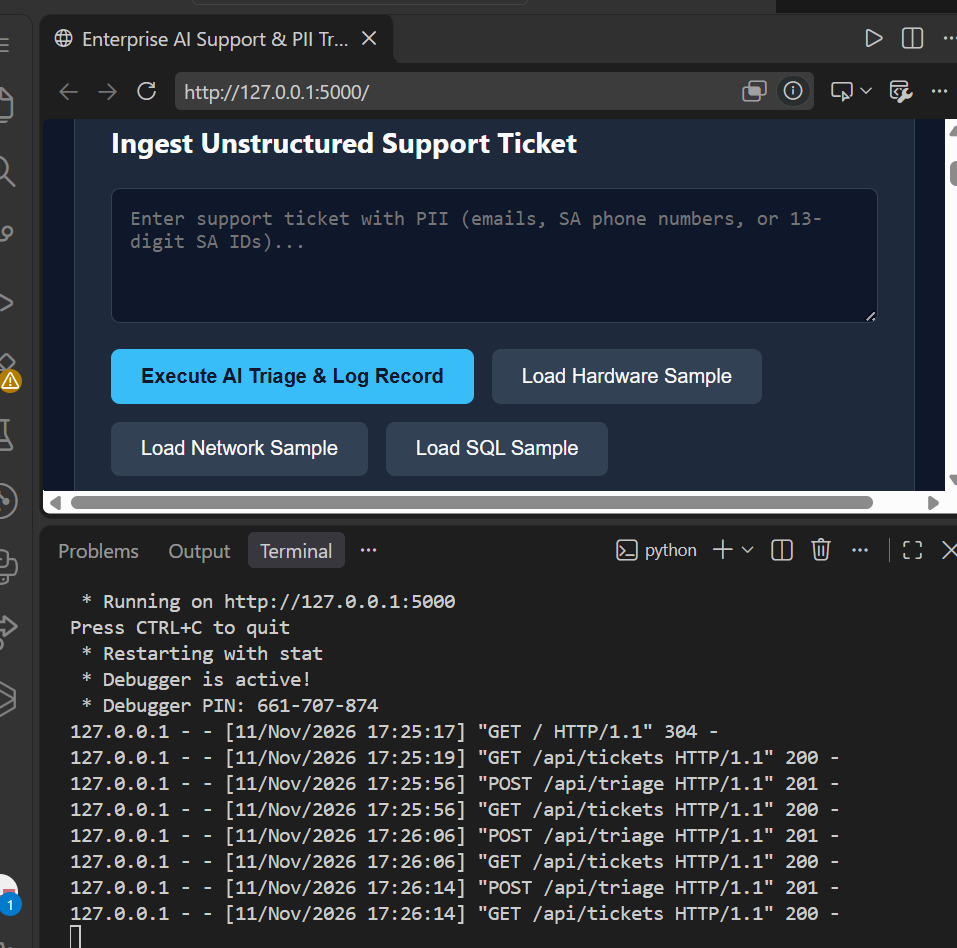

# Enterprise AI Support & PII Triage Engine


An enterprise IT support triage pipeline that ingests unstructured support tickets, automatically redacts Personally Identifiable Information (PII), classifies issue categories and urgency sentiment using a Local LLM (Ollama) via the OpenAI Python SDK, and logs audited records into an indexed SQLite database.

**[Launch Live Interactive Web Demo](https://carinaAlexiaC.github.io/enterprise-ai-triage-engine/)**

## Application Interface Preview



## System Architecture

```mermaid
flowchart TD
    A[Client Browser: ES6 Async/Await UI] -->|POST /api/triage JSON| B(Flask REST API Controller)
    B --> C[PII Sanitization Layer: Regex Masking]
    C -->|Sanitized String| D{Local Ollama LLM Active?}
    D -->|Yes: OpenAI SDK HTTP| E[Local Llama / Qwen JSON Triage]
    D -->|No: Automatic Failover| F[Deterministic Keyword NLP Engine]
    E --> G[Parameterized SQL Insert ?]
    F --> G
    G --> H[(SQLite DB: Non-Clustered Index on Category & Sentiment)]